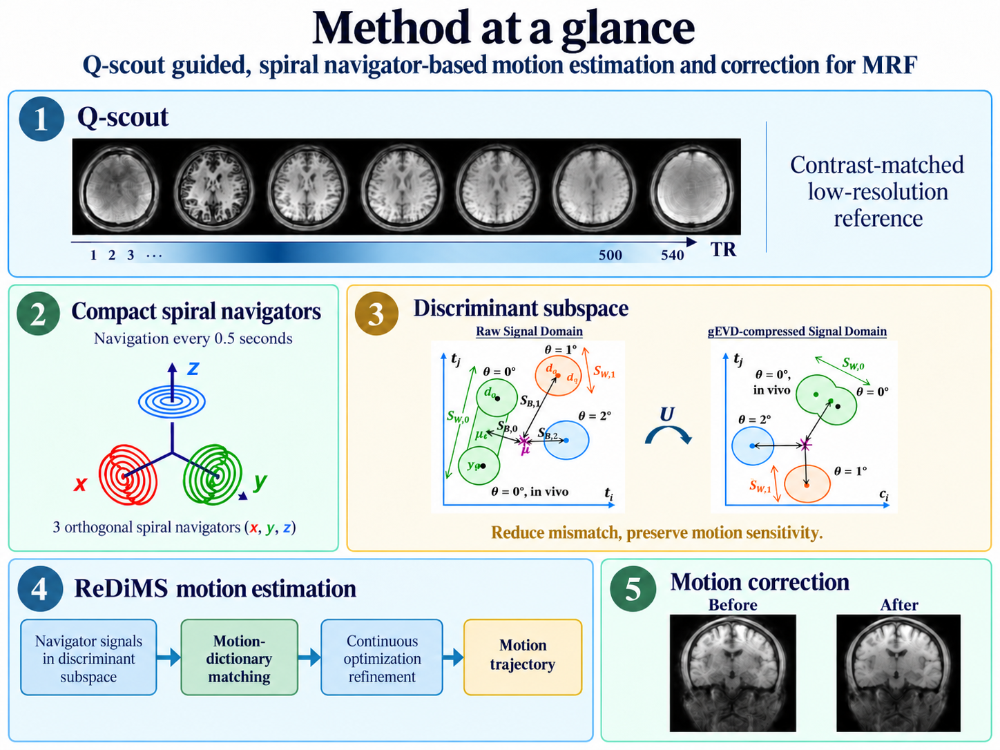
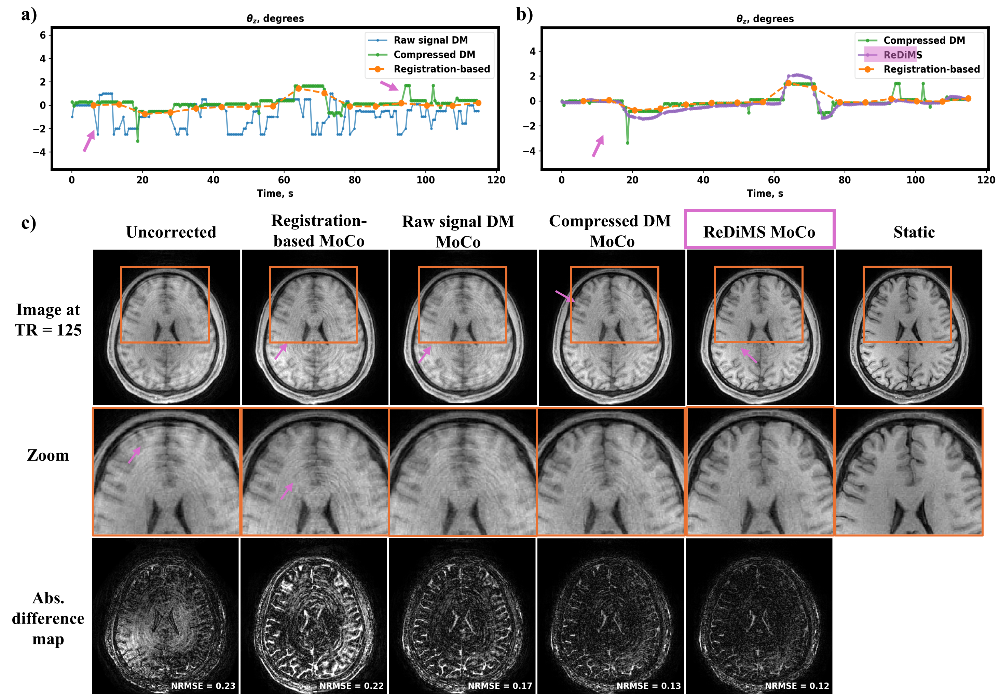

# Sub-Second Contrast-Aware Motion Navigation in Magnetic Resonance Fingerprinting

Research code accompanying the manuscript:

**Sub-Second Contrast-Aware Motion Navigation in Magnetic Resonance Fingerprinting**  
Aizada Nurdinova, Xiaozhi Cao, Daniel R. Abraham, Daniel Polak, Nan Wang, Xuetong Zhou, Yimeng Lin, Brian A. Hargreaves, and Kawin Setsompop

## Overview

Magnetic Resonance Fingerprinting (MRF) has continuously varying contrast, so navigator signal changes can arise from both motion and spin-history/contrast effects. This work introduces a contrast-aware navigation framework for 3D spiral-projection MRF that estimates 6-DOF rigid motion from compact spiral navigators acquired every **0.5 s**.

The framework uses a contrast-matched **Q-scout**, three orthogonal spiral navigators, a **gEVD discriminant subspace** to reduce sensitivity to measured-versus-simulated signal mismatch, and **ReDiMS** (*Refined Dictionary Matching in a discriminant Subspace*) for motion estimation.

## Method at a glance

<p align="center">
  
</p>

The pipeline consists of:

1. **Q-scout:** a low-resolution reference with contrast evolution matched to the MRF acquisition.
2. **Compact spiral navigators:** three orthogonal readouts provide navigation every 0.5 s.
3. **Discriminant subspace:** contrast-specific gEVD compression preserves motion sensitivity while reducing signal mismatch.
4. **ReDiMS motion estimation:** motion-dictionary matching provides an initialization, followed by continuous optimization refinement to estimate the motion trajectory.
5. **Motion correction:** the estimated trajectory is incorporated into retrospective MRF reconstruction.


## Results

<p align="center">
  
</p>

The representative example shows the progression from raw-signal dictionary matching to gEVD-compressed matching and continuous ReDiMS refinement, together with the corresponding motion-corrected reconstruction.

### Cohort-level evaluation


The method was evaluated on **11 static scans** and **36 motion-corrupted acquisitions** with corresponding motion-free references. In static and slow motion datasets, ReDiMS aligned well with the registration-based baseline method. ReDiMS correction achieved lower NRMSE than registration-based correction in **34/36 motion cases**, with the largest additional benefit observed for large, high-frequency motion.

## Data availability

An exemplary dataset containing **motion-free and motion-corrupted acquisitions from one subject** is available upon request.

## Scope

The current implementation estimates rigid-body motion and performs retrospective motion correction. Dynamic field changes, motion-induced coil-sensitivity changes, eddy-current effects, and non-rigid motion are not explicitly modeled.

## Citation

In the meantime, please cite the current arXiv preprint:

[Nurdinova et al., *High-Temporal-Resolution Motion Correction in Magnetic Resonance Fingerprinting Using a Quantitative Scout and Compact Spiral Navigators*, arXiv:2609.25313 (2026)](https://arxiv.org/abs/2609.25313)

```bibtex
@article{nurdinova2026high,
  title   = {High-Temporal-Resolution Motion Correction in Magnetic Resonance Fingerprinting Using a Quantitative Scout and Compact Spiral Navigators},
  author  = {Nurdinova, Aizada and Cao, Xiaozhi and Abraham, Daniel R. and
             Polak, Daniel and Wang, Nan and Zhou, Xuetong and Lin, Yimeng and
             Hargreaves, Brian A. and Setsompop, Kawin},
  journal = {arXiv preprint arXiv:2609.25313},
  year    = {2026}
}
```
